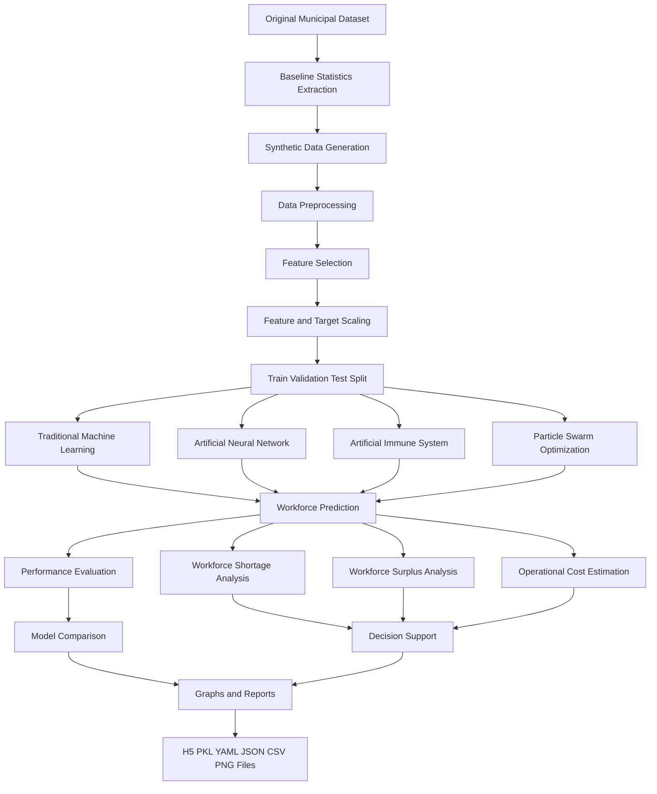
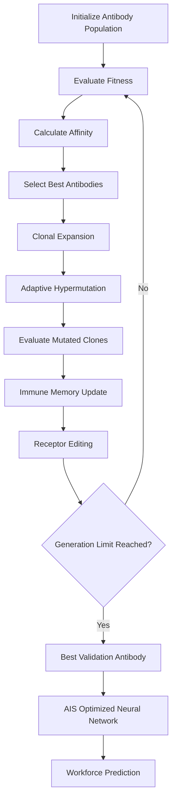
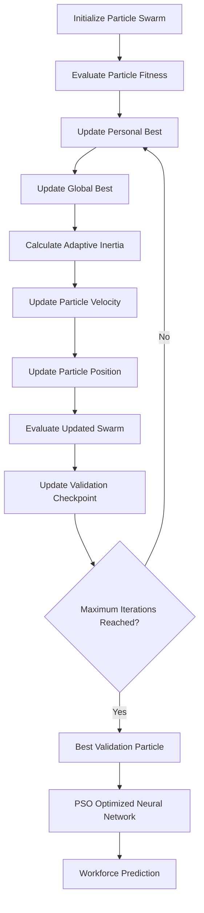
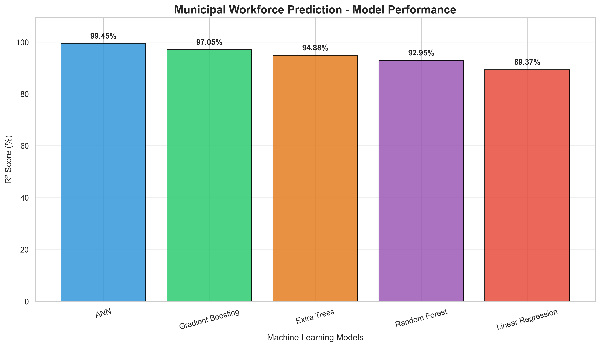

# AI-Based Municipal Waste Management and Conservancy Workforce Optimization Using AIS and PSO


## Project Overview

The AI-Based Municipal Waste Management and Conservancy Workforce Optimization project is an intelligent decision-support framework designed to estimate municipal workforce requirements, analyze resource utilization, identify workforce shortages and surpluses, and estimate operational expenditure.

The project integrates traditional Machine Learning, Artificial Neural Networks (ANN), Artificial Immune Systems (AIS), and Particle Swarm Optimization (PSO) to investigate intelligent approaches to municipal waste management.

The framework considers operational factors such as waste generation, disposal sites, population density, worker productivity, equipment efficiency, absenteeism, transportation distance, and seasonal demand.

AIS and PSO are employed to optimize neural network weights and biases, providing alternative approaches to conventional gradient-based neural network training.

The project aims to support research into intelligent, sustainable, and resource-efficient municipal waste management systems.

> **Research Note:** The original dataset contains only one aggregate municipal record. Therefore, the experimental framework uses 10,000 synthetic operational scenarios. Reported performance represents simulation-based evaluation rather than validated real-world municipal performance.

---

## Table of Contents

- Project Overview
- Problem Statement
- Project Objectives
- Dataset Description
- Synthetic Data Generation
- System Architecture
- Technologies Used
- Machine Learning Algorithms
- Artificial Neural Network
- Artificial Immune System
- Particle Swarm Optimization
- Mathematical Formulation
- Installation
- Project Execution
- Project Structure
- Performance Visualization
- Evaluation Metrics
- Generated Output Files
- Workforce Analysis
- Applications
- Advantages
- Limitations
- Future Enhancements
- Research Opportunities
- Conclusion
- References

---

## Problem Statement

Municipal waste management organizations face significant challenges in efficiently managing conservancy workers, garbage disposal facilities, sanitation operations, and operational expenditure.

Traditional workforce allocation methods may depend on fixed staffing policies and manual assessments that do not adequately consider changing operational requirements.

Major challenges include:

- Inefficient workforce allocation.
- Shortage of conservancy workers.
- Excess workforce availability in certain operational scenarios.
- Increasing municipal waste generation.
- Inadequate resource utilization.
- High operational expenditure.
- Variations in worker productivity.
- Seasonal fluctuations in waste generation.
- Equipment inefficiency.
- Lack of intelligent workforce prediction systems.

This project investigates an AI-based solution capable of estimating workforce demand and generating scenario-based resource management recommendations.

---

## Project Objectives

The primary objectives of this project are:

- Analyze municipal conservancy workforce statistics.
- Generate synthetic municipal operational scenarios.
- Predict required conservancy workforce using machine learning.
- Develop an Artificial Neural Network for workforce estimation.
- Optimize neural network parameters using AIS.
- Optimize neural network parameters using PSO.
- Identify workforce shortages and surpluses.
- Estimate municipal workforce utilization.
- Estimate daily operational expenditure.
- Compare conventional and bio-inspired learning algorithms.
- Generate analytical graphs and performance reports.
- Develop reusable machine learning model files.
- Support research into intelligent municipal resource management.

---

## Dataset Description

### Original Dataset

The original dataset used in this project is:

`number_of conservancy_workers_engaged_in_conservancy_garbage_and_debris_disposal_and_other_particulars_2017_18.csv`

The dataset contains aggregate information about conservancy workers, garbage and sewage disposal sites, and personnel engaged in related municipal activities during 2017–2018.

### Original Dataset Attributes

| Attribute | Description |
|---|---|
| S.No | Serial number |
| Number of workers engaged in conservancy work | Conservancy workforce |
| Number of garbage and sewage disposal dump site | Number of disposal facilities |
| Number of persons engaged in other connected works related with conservancy | Supporting workforce |

### Original Dataset Statistics

| Parameter | Value |
|---|---:|
| Original records | 1 |
| Original attributes | 4 |
| Conservancy workers | 847 |
| Garbage and sewage disposal sites | 105 |
| Workers engaged in connected activities | 412 |
| Combined workforce, assuming non-overlapping categories | 1,259 |
| Aggregate conservancy workers per disposal site | 8.07 |

The aggregate workers-per-site ratio does not represent verified staffing at individual disposal facilities.

---

## Synthetic Data Generation

Since the original dataset contains insufficient observations for conventional supervised machine learning, a synthetic dataset is generated using the original aggregate statistics as baseline parameters.

### Synthetic Dataset

`synthetic_municipal_dataset.csv`

### Number of Generated Records

10,000 synthetic municipal operational scenarios.

### Synthetic Dataset Attributes

| Feature | Description |
|---|---|
| disposal_sites | Number of operational disposal sites |
| available_workers | Available conservancy workforce |
| other_workers | Supporting municipal workforce |
| daily_waste_tonnes | Estimated daily waste generation |
| population_density | Simulated population density |
| working_hours | Daily working hours |
| worker_productivity | Worker productivity factor |
| equipment_efficiency | Equipment efficiency factor |
| absenteeism_rate | Workforce absenteeism rate |
| transport_distance_km | Transportation distance |
| seasonal_demand_factor | Seasonal variation in demand |
| daily_wage | Assumed daily wage per worker |
| required_workers | Simulated workforce requirement |
| workforce_shortage | Estimated workforce shortage |
| workforce_surplus | Estimated workforce surplus |
| workforce_utilization | Estimated workforce utilization |
| estimated_daily_cost | Estimated daily workforce expenditure |

### Simulation Parameters

| Parameter | Assumed Range |
|---|---|
| Waste per site per day | 3–12 tonnes |
| Working hours | 6–10 hours |
| Worker productivity | 0.6–1.4 |
| Equipment efficiency | 0.55–0.98 |
| Absenteeism rate | 2–20% |
| Transportation distance | 2–30 km |
| Seasonal demand factor | 0.8–1.5 |
| Daily wage | INR 400–1,000 |
| Nominal handling capacity | 0.18 tonnes per worker per hour |
| Minimum workers per disposal site | 2 |

These parameters are experimental assumptions and are not independently verified municipal measurements.

---

## System Architecture



---

## Technologies Used

| Technology | Purpose |
|---|---|
| Python | Primary programming language |
| NumPy | Numerical computation |
| Pandas | Dataset processing and analysis |
| Scikit-learn | Machine learning and evaluation |
| TensorFlow | Deep learning framework |
| Keras | Neural network development |
| Matplotlib | Data visualization |
| Seaborn | Statistical visualization |
| Joblib | Model serialization |
| PyYAML | Configuration management |
| H5py | HDF5 model storage |
| JSON | Structured performance reporting |
| Jupyter Notebook | Experimental development environment |
| AIS | Bio-inspired optimization |
| PSO | Swarm intelligence optimization |

---

## Machine Learning Algorithms

### 1. Linear Regression

Linear Regression establishes a baseline relationship between municipal operational features and workforce requirements.

It estimates the target variable using a linear combination of input features.

Mathematical representation:

$$
\hat{y} = \beta_0 + \sum_{i=1}^{n}\beta_i x_i
$$

Where:

- x represents input features.
- β represents regression coefficients.
- ŷ represents predicted workforce requirements.

### 2. Random Forest Regression

Random Forest is an ensemble learning algorithm that combines multiple decision trees to generate workforce predictions.

Advantages:

- Captures nonlinear relationships.
- Supports feature importance analysis.
- Reduces variance through ensemble learning.
- Handles complex operational variables.

### 3. Gradient Boosting Regression

Gradient Boosting sequentially constructs predictive models that attempt to correct errors produced by previous models.

Advantages:

- Models complex relationships.
- Supports nonlinear regression.
- Provides configurable learning rates.
- Improves predictions through sequential learning.

### 4. Extra Trees Regression

Extra Trees uses randomized decision trees to generate ensemble-based predictions.

Advantages:

- Randomized feature splitting.
- Efficient ensemble learning.
- Reduced dependence on individual decision trees.
- Support for feature importance estimation.

### 5. Artificial Neural Network

An Artificial Neural Network learns nonlinear relationships between municipal operational parameters and workforce requirements.

The conventional ANN uses gradient-based optimization through the Adam optimizer.

---

## Artificial Neural Network Architecture

### Conventional ANN

| Layer | Neurons | Activation |
|---|---:|---|
| Input | 10 | None |
| Hidden Layer 1 | 128 | ReLU |
| Dropout | 10% | None |
| Hidden Layer 2 | 64 | ReLU |
| Hidden Layer 3 | 32 | ReLU |
| Hidden Layer 4 | 16 | ReLU |
| Output | 1 | Linear |

### ANN Training Configuration

| Parameter | Value |
|---|---|
| Optimizer | Adam |
| Learning rate | 0.001 |
| Maximum epochs | 200 |
| Batch size | 64 |
| Loss function | Mean Squared Error |
| Early stopping patience | 20 |
| Feature scaling | StandardScaler |
| Target scaling | StandardScaler |

---

## Artificial Immune System (AIS)

Artificial Immune System is a bio-inspired computational optimization technique inspired by the adaptive immune system.

This project implements the Clonal Selection Algorithm (CLONALG) to optimize neural network weights and biases.

### AIS Optimization Process

1. Initialize the antibody population.
2. Represent neural network parameters as antibodies.
3. Evaluate antibody fitness.
4. Calculate antibody affinity.
5. Select high-affinity antibodies.
6. Generate antibody clones.
7. Apply adaptive hypermutation.
8. Evaluate mutated antibodies.
9. Retain high-performing antibodies.
10. Perform receptor editing.
11. Maintain the best validation antibody.
12. Repeat until the generation limit is reached.

### AIS Workflow



### AIS Hyperparameters

| Parameter | Value |
|---|---:|
| Population size | 40 |
| Maximum generations | 150 |
| Selected antibodies | 10 |
| Base clones per antibody | 5 |
| Initial mutation strength | 0.15 |
| Minimum mutation strength | 0.005 |
| Receptor editing rate | 0.15 |
| Weight limit | 5.0 |
| Regularization coefficient | 0.0001 |
| Random seed | 42 |

### AIS Affinity Function

$$
Affinity(A_i) = \frac{1}{1 + F(A_i)}
$$

Where:

- A represents an antibody.
- F represents the fitness function.
- Higher affinity represents lower fitness loss.

### AIS Hypermutation

$$
\sigma_i = \max(\sigma_{min}, \sigma_t e^{-2a_i})
$$

$$
A_i' = A_i + M \odot \mathcal{N}(0,\sigma_i^2)
$$

Where:

- σ represents mutation strength.
- a represents antibody affinity.
- M represents a random mutation mask.
- A' represents the mutated antibody.

High-affinity antibodies receive smaller mutations to preserve promising solutions.

---

## Particle Swarm Optimization (PSO)

Particle Swarm Optimization is a population-based optimization algorithm inspired by the collective behavior of bird flocks and fish schools.

In this project, PSO optimizes the neural network weights and biases for municipal workforce requirement prediction.

Each particle represents a candidate neural network parameter vector.

### PSO Optimization Process

1. Initialize particle positions and velocities.
2. Evaluate the fitness of each particle.
3. Identify personal best positions.
4. Identify the global best position.
5. Update the adaptive inertia weight.
6. Calculate cognitive and social components.
7. Update particle velocities.
8. Update particle positions.
9. Evaluate updated particles.
10. Update personal and global best solutions.
11. Retain the best validation checkpoint.
12. Repeat until the maximum iteration limit.

### PSO Workflow



### PSO Hyperparameters

| Parameter | Value |
|---|---:|
| Swarm size | 40 |
| Maximum iterations | 150 |
| Maximum inertia weight | 0.9 |
| Minimum inertia weight | 0.4 |
| Cognitive coefficient | 1.5 |
| Social coefficient | 1.5 |
| Position limit | ±5.0 |
| Velocity limit | ±0.3 |
| Regularization coefficient | 0.0001 |
| Random seed | 42 |

### PSO Velocity Update

$$
v_i^{t+1} = wv_i^t + c_1r_1(p_i-x_i^t) + c_2r_2(g-x_i^t)
$$

### PSO Position Update

$$
x_i^{t+1} = x_i^t + v_i^{t+1}
$$

Where:

- v represents particle velocity.
- x represents particle position.
- w represents inertia weight.
- c1 represents the cognitive coefficient.
- c2 represents the social coefficient.
- r1 and r2 represent random numbers.
- p represents the personal best position.
- g represents the global best position.

### Adaptive Inertia Weight

$$
w_t = w_{max} - (w_{max}-w_{min})\frac{t-1}{T-1}
$$

The inertia weight gradually decreases from 0.9 to 0.4 to balance exploration and exploitation.

---

## AIS and PSO Neural Network Architecture

Both AIS and PSO optimize the same neural network architecture.

| Layer | Neurons | Activation |
|---|---:|---|
| Input Layer | 10 | None |
| Hidden Layer 1 | 16 | ReLU |
| Hidden Layer 2 | 8 | ReLU |
| Output Layer | 1 | Linear |

### Total Trainable Parameters

$$
D = (10 \times 16 + 16) + (16 \times 8 + 8) + (8 \times 1 + 1)
$$

$$
D = 321
$$

Both optimization algorithms search for suitable values for these 321 neural network parameters.

Unlike the conventional ANN, AIS and PSO directly optimize the network parameters without backpropagation.

---

## Mathematical Formulation

### 1. Effective Worker Capacity

$$
C_{eff} = C_0 \times H \times P \times E \times (1-A)
$$

Where:

- C0 = Nominal waste handling capacity.
- H = Working hours.
- P = Worker productivity.
- E = Equipment efficiency.
- A = Absenteeism rate.

### 2. Adjusted Waste Demand

$$
W_{adj} = W \times S
$$

Where:

- W = Daily waste generation.
- S = Seasonal demand factor.

### 3. Population Density Factor

$$
F_d = 1 + \frac{D_p}{100000}
$$

### 4. Transportation Factor

$$
F_t = 1 + \frac{T_d}{100}
$$

### 5. Supporting Workforce Factor

$$
F_s = 1 + 0.15\frac{N_s}{N_{s0}}
$$

### 6. Workforce Requirement

$$
R = \frac{W_{adj} \times F_d \times F_t}{C_{eff} \times F_s}
$$

The simulated target includes random operational noise and a minimum staffing constraint.

$$
R_{final} = \max(2N_d,\lceil \max(R,2N_d)(1+\epsilon)\rceil)
$$

Where:

- Nd = Number of disposal sites.
- ε = Simulated Gaussian noise.
- Rfinal = Final simulated workforce requirement.

### 7. Workforce Shortage

$$
Shortage = \max(R_{pred}-W_a,0)
$$

### 8. Workforce Surplus

$$
Surplus = \max(W_a-R_{pred},0)
$$

### 9. Workforce Utilization

$$
Utilization = \min\left(\frac{R_{pred}}{W_a},1\right)\times100
$$

This metric represents estimated workforce demand relative to available staffing, capped at 100%.

### 10. Estimated Daily Workforce Cost

$$
Cost = R_{pred} \times C_w
$$

Where:

- Rpred = Predicted workforce requirement.
- Wa = Available workforce.
- Cw = Daily wage per worker.

### 11. AIS and PSO Fitness Function

$$
F(\theta)=\frac{1}{N}\sum_{i=1}^{N}(y_i-\hat{y}_i)^2+
\frac{\lambda}{D}\sum_{j=1}^{D}\theta_j^2
$$

Where:

- θ represents neural network parameters.
- N represents training observations.
- D represents the number of parameters.
- λ represents the regularization coefficient.
- y represents scaled reference targets.
- ŷ represents scaled predictions.

The objective is to minimize regularized training prediction error.

---

## Data Preprocessing

The following preprocessing operations are performed:

- Dataset loading.
- Column name normalization.
- Numerical data validation.
- Missing value verification.
- Synthetic scenario generation.
- Feature selection.
- Target variable selection.
- Dataset splitting.
- Feature standardization.
- Neural network target standardization.
- Integer workforce prediction constraints.

### Input Features

```python
FEATURES = [
    "disposal_sites",
    "other_workers",
    "daily_waste_tonnes",
    "population_density",
    "working_hours",
    "worker_productivity",
    "equipment_efficiency",
    "absenteeism_rate",
    "transport_distance_km",
    "seasonal_demand_factor"
]
```

### Target Variable

```python
TARGET = "required_workers"
```

### Dataset Splitting

| Dataset | Percentage | Records |
|---|---:|---:|
| Training | 64% | 6,400 |
| Validation | 16% | 1,600 |
| Testing | 20% | 2,000 |
| Total | 100% | 10,000 |

The same random seed and dataset splitting strategy are used across the baseline, AIS, and PSO implementations.

Feature and target scalers are fitted using training data only.

Validation data is used for model selection, while testing data is reserved for final performance evaluation.

---

## Installation

### Prerequisites

- Python 3.10 or another compatible Python version.
- Jupyter Notebook or JupyterLab.
- Compatible TensorFlow installation.
- Minimum recommended RAM: 8 GB.
- Internet connection for dependency installation.

### Install Required Libraries

```bash
pip install numpy pandas matplotlib seaborn scikit-learn tensorflow h5py joblib pyyaml jupyter
```

### Install Libraries in Jupyter Notebook

```python
!pip install numpy pandas matplotlib seaborn scikit-learn tensorflow h5py joblib pyyaml
```

### Start Jupyter Notebook

```bash
jupyter notebook
```

---

## Project Execution

### Step 1: Configure Dataset Path

```python
DATASET_PATH = r"C:\Users\sagni\Downloads\AI-Based Municipal Waste Management and Conservancy Workforce\number_of conservancy_workers_engaged_in_conservancy_garbage_and_debris_disposal_and_other_particulars_2017_18.csv"
```

### Step 2: Configure Output Directory

```python
OUTPUT_DIR = r"C:\Users\sagni\Downloads\AI-Based Municipal Waste Management and Conservancy Workforce"
```

Update these paths according to your local system.

### Step 3: Execute Baseline Training

Run the baseline machine learning and ANN implementation.

This generates:

- Synthetic dataset.
- Trained machine learning models.
- Artificial Neural Network.
- Feature and target scalers.
- YAML configuration.
- JSON evaluation metrics.

### Step 4: Execute Performance Visualization

Run the baseline evaluation and visualization implementation.

This generates:

- Accuracy graph.
- Correlation heatmap.
- Model comparison graph.
- Result CSV.
- Prediction CSV.
- Workforce analysis graphs.

### Step 5: Execute AIS Implementation

Run the AIS-based neural network optimization implementation.

All generated AIS files use the following prefix:

```text
ais_
```

### Step 6: Execute PSO Implementation

Run the PSO-based neural network optimization implementation.

All generated PSO files use the following prefix:

```text
pso_
```

### Step 7: Analyze Experimental Results

Compare the generated CSV files:

```text
result.csv
ais_result.csv
pso_result.csv
pso_comparison.csv
```

Compare the generated prediction files:

```text
prediction.csv
ais_prediction.csv
pso_prediction.csv
```

---

## Project Structure

The following is the recommended repository structure after saving the implementation code and executing all experiments.

```text
AI-Based-Municipal-Waste-Management/
│
├── README.md
├── requirements.txt
│
├── number_of conservancy_workers_engaged_in_conservancy_garbage_and_debris_disposal_and_other_particulars_2017_18.csv
├── synthetic_municipal_dataset.csv
│
├── baseline_training.ipynb
├── baseline_visualization.ipynb
├── ais_optimization.ipynb
├── pso_optimization.ipynb
│
├── model.h5
├── model.pkl
├── model_bundle.pkl
├── model_architecture.json
├── config.yaml
├── metrics.json
├── scaler.pkl
├── target_scaler.pkl
│
├── linear_regression_model.pkl
├── random_forest_model.pkl
├── gradient_boosting_model.pkl
├── extra_trees_model.pkl
│
├── accuracy_graph.png
├── heatmap.png
├── comparison_graph.png
├── result.csv
├── result_graph.png
├── prediction.csv
├── prediction_graph.png
├── model_comparison.csv
├── training_history.csv
├── training_loss_graph.png
├── actual_vs_predicted.png
├── workforce_summary.csv
├── workforce_allocation_graph.png
├── workforce_shortage_graph.png
├── workforce_status_graph.png
├── workforce_utilization_graph.png
├── operational_cost_graph.png
├── residual_graph.png
├── error_distribution_graph.png
├── feature_importance.csv
├── feature_importance_graph.png
├── correlation_matrix.csv
├── evaluation_results.json
│
├── ais_model.h5
├── ais_model.pkl
├── ais_config.yaml
├── ais_metrics.json
├── ais_model_architecture.json
├── ais_scaler.pkl
├── ais_target_scaler.pkl
├── ais_best_antibody.npy
├── ais_dataset.csv
├── ais_accuracy_graph.png
├── ais_heatmap.png
├── ais_comparison.csv
├── ais_comparison_graph.png
├── ais_result.csv
├── ais_result_graph.png
├── ais_prediction.csv
├── ais_prediction_graph.png
├── ais_convergence_history.csv
├── ais_convergence_graph.png
├── ais_affinity_graph.png
├── ais_population_diversity_graph.png
├── ais_actual_vs_predicted.png
├── ais_residual_graph.png
├── ais_error_distribution_graph.png
├── ais_workforce_summary.csv
├── ais_workforce_allocation_graph.png
├── ais_workforce_shortage_graph.png
├── ais_workforce_status_graph.png
├── ais_workforce_utilization_graph.png
├── ais_operational_cost_graph.png
├── ais_feature_importance.csv
├── ais_feature_importance_graph.png
├── ais_correlation_matrix.csv
├── ais_new_scenario_prediction.csv
│
├── pso_model.h5
├── pso_model.pkl
├── pso_config.yaml
├── pso_metrics.json
├── pso_model_architecture.json
├── pso_scaler.pkl
├── pso_target_scaler.pkl
├── pso_best_particle.npy
├── pso_global_best_particle.npy
├── pso_swarm_state.npz
├── pso_dataset.csv
├── pso_accuracy_graph.png
├── pso_heatmap.png
├── pso_comparison.csv
├── pso_comparison_graph.png
├── pso_result.csv
├── pso_result_graph.png
├── pso_prediction.csv
├── pso_prediction_graph.png
├── pso_convergence_history.csv
├── pso_convergence_graph.png
├── pso_fitness_graph.png
├── pso_swarm_diversity_graph.png
├── pso_velocity_graph.png
├── pso_inertia_graph.png
├── pso_actual_vs_predicted.png
├── pso_residual_graph.png
├── pso_error_distribution_graph.png
├── pso_workforce_summary.csv
├── pso_workforce_allocation_graph.png
├── pso_workforce_shortage_graph.png
├── pso_workforce_status_graph.png
├── pso_workforce_utilization_graph.png
├── pso_operational_cost_graph.png
├── pso_feature_importance.csv
├── pso_feature_importance_graph.png
├── pso_correlation_matrix.csv
├── pso_new_scenario_prediction.csv
├── pso_ais_prediction_comparison.csv
├── pso_ais_prediction_comparison_graph.png
└── pso_ais_convergence_comparison.png
```

The notebook filenames and requirements.txt are suggested repository organization files. Save the corresponding implementations manually using these names.

AIS–PSO comparison files are generated only when compatible AIS output files are available.

---

## Performance Visualization

### Machine Learning Model Performance

The following graph presents the regression performance of the conventional machine learning models and Artificial Neural Network.



The graph compares:

- Linear Regression.
- Random Forest Regression.
- Gradient Boosting Regression.
- Extra Trees Regression.
- Artificial Neural Network.

The visualization uses the coefficient of determination (R²), expressed as a percentage.

Higher R² values generally indicate better predictive performance relative to the mean-target baseline.

The graph is generated automatically after executing the baseline visualization implementation.

**Note:** R² expressed as a percentage is not classification accuracy and may be negative for poorly performing regression models.

---

## Additional Visualizations

| Visualization | Filename |
|---|---|
| Feature correlation heatmap | heatmap.png |
| Model comparison | comparison_graph.png |
| Validation and testing results | result_graph.png |
| Actual versus predicted workforce | prediction_graph.png |
| Prediction scatter plot | actual_vs_predicted.png |
| Workforce allocation | workforce_allocation_graph.png |
| Workforce shortage and surplus | workforce_shortage_graph.png |
| Workforce status distribution | workforce_status_graph.png |
| Workforce utilization | workforce_utilization_graph.png |
| Operational cost analysis | operational_cost_graph.png |
| Residual error analysis | residual_graph.png |
| Error distribution | error_distribution_graph.png |
| Feature importance | feature_importance_graph.png |
| ANN training loss | training_loss_graph.png |
| AIS performance | ais_accuracy_graph.png |
| AIS convergence | ais_convergence_graph.png |
| AIS affinity evolution | ais_affinity_graph.png |
| AIS population diversity | ais_population_diversity_graph.png |
| PSO performance | pso_accuracy_graph.png |
| PSO convergence | pso_convergence_graph.png |
| PSO fitness evolution | pso_fitness_graph.png |
| PSO swarm diversity | pso_swarm_diversity_graph.png |
| PSO particle velocity | pso_velocity_graph.png |
| PSO adaptive inertia | pso_inertia_graph.png |
| AIS versus PSO predictions | pso_ais_prediction_comparison_graph.png |
| AIS versus PSO convergence | pso_ais_convergence_comparison.png |

---

## Performance Evaluation Metrics

### Mean Absolute Error (MAE)

$$
MAE = \frac{1}{N}\sum_{i=1}^{N}|y_i-\hat{y}_i|
$$

MAE measures the average absolute difference between simulated reference workforce requirements and predicted workforce requirements.

Lower values indicate better performance.

### Mean Squared Error (MSE)

$$
MSE = \frac{1}{N}\sum_{i=1}^{N}(y_i-\hat{y}_i)^2
$$

MSE penalizes larger prediction errors.

### Root Mean Squared Error (RMSE)

$$
RMSE = \sqrt{\frac{1}{N}\sum_{i=1}^{N}(y_i-\hat{y}_i)^2}
$$

RMSE represents prediction error in workforce units.

### Coefficient of Determination (R²)

$$
R^2 = 1-\frac{\sum_{i=1}^{N}(y_i-\hat{y}_i)^2}
{\sum_{i=1}^{N}(y_i-\bar{y})^2}
$$

R² measures predictive performance relative to predicting the mean target value.

### Mean Absolute Percentage Error (MAPE)

$$
MAPE = \frac{100}{N}\sum_{i=1}^{N}
\left|\frac{y_i-\hat{y}_i}{y_i}\right|
$$

MAPE measures the average absolute prediction error as a percentage of the reference target.

### Metric Interpretation

| Metric | Preferred Direction |
|---|---|
| MAE | Lower |
| MSE | Lower |
| RMSE | Lower |
| R² | Higher |
| MAPE | Lower |
| Fitness loss | Lower |
| Validation loss | Lower |
| AIS affinity | Higher |

---

## Experimental Model Comparison

The project compares seven predictive approaches.

| Model | Category | Optimization Method |
|---|---|---|
| Linear Regression | Machine Learning | Least Squares |
| Random Forest | Ensemble Learning | Bagging |
| Gradient Boosting | Ensemble Learning | Sequential Boosting |
| Extra Trees | Ensemble Learning | Randomized Trees |
| ANN | Deep Learning | Adam |
| AIS-ANN | Bio-inspired AI | Clonal Selection |
| PSO-ANN | Swarm Intelligence | Particle Swarm Optimization |

### Experimental Results

Numerical results are generated dynamically after executing the experiments.

The following files contain the measured performance values:

| Result File | Description |
|---|---|
| result.csv | Baseline model evaluation |
| ais_result.csv | AIS training, validation and testing results |
| pso_result.csv | PSO training, validation and testing results |
| ais_comparison.csv | AIS versus baseline models |
| pso_comparison.csv | PSO versus AIS and baseline models |

### Display Model Comparison

```python
import pandas as pd

results = pd.read_csv("pso_comparison.csv")

print(results.round(4).to_string(index=False))
```

No fixed performance values are claimed before executing the experiments.

---

## Generated Model Files

| File | Description |
|---|---|
| model.h5 | Conventional trained neural network |
| model.pkl | Best traditional machine learning model |
| model_bundle.pkl | Machine learning model with preprocessing |
| ais_model.h5 | AIS-optimized neural network |
| ais_model.pkl | AIS parameter and preprocessing bundle |
| pso_model.h5 | PSO-optimized neural network |
| pso_model.pkl | PSO parameter and preprocessing bundle |

### Configuration Files

| File | Description |
|---|---|
| config.yaml | Baseline project configuration |
| ais_config.yaml | AIS hyperparameters and configuration |
| pso_config.yaml | PSO hyperparameters and configuration |

### JSON Files

| File | Description |
|---|---|
| metrics.json | Baseline model performance |
| evaluation_results.json | Baseline evaluation report |
| model_architecture.json | Conventional ANN architecture |
| ais_metrics.json | AIS performance metrics |
| ais_model_architecture.json | AIS neural network architecture |
| pso_metrics.json | PSO performance metrics |
| pso_model_architecture.json | PSO neural network architecture |

---

## Model Loading and Prediction

### Load the Traditional Machine Learning Model

```python
import joblib

bundle = joblib.load("model_bundle.pkl")

model = bundle["model"]
scaler = bundle["scaler"]
features = bundle["features"]

print("Loaded Model:", bundle["model_name"])
```

### Load AIS Model

```python
import joblib
from tensorflow.keras.models import load_model

ais_model = load_model(
    "ais_model.h5",
    compile=False
)

ais_scaler = joblib.load("ais_scaler.pkl")

ais_target_scaler = joblib.load(
    "ais_target_scaler.pkl"
)
```

### Load PSO Model

```python
import joblib
from tensorflow.keras.models import load_model

pso_model = load_model(
    "pso_model.h5",
    compile=False
)

pso_scaler = joblib.load("pso_scaler.pkl")

pso_target_scaler = joblib.load(
    "pso_target_scaler.pkl"
)
```

Only load serialized models from trusted sources.

---

## Example Workforce Prediction

The following example demonstrates workforce requirement prediction using the saved PSO model.

```python
import numpy as np
import pandas as pd
import joblib

from tensorflow.keras.models import load_model

bundle = joblib.load("pso_model.pkl")

model = load_model(
    "pso_model.h5",
    compile=False
)

scaler = bundle["feature_scaler"]
target_scaler = bundle["target_scaler"]
features = bundle["features"]

new_scenario = pd.DataFrame([{
    "disposal_sites": 105,
    "other_workers": 412,
    "daily_waste_tonnes": 650,
    "population_density": 12000,
    "working_hours": 8,
    "worker_productivity": 1.0,
    "equipment_efficiency": 0.85,
    "absenteeism_rate": 0.08,
    "transport_distance_km": 10,
    "seasonal_demand_factor": 1.1
}])

X_scaled = scaler.transform(
    new_scenario[features]
)

scaled_prediction = model.predict(
    X_scaled,
    verbose=0
)

prediction = target_scaler.inverse_transform(
    scaled_prediction
)[0][0]

required_workers = max(
    int(np.ceil(prediction)),
    int(new_scenario["disposal_sites"].iloc[0]) * 2
)

available_workers = 847

shortage = max(
    required_workers - available_workers,
    0
)

surplus = max(
    available_workers - required_workers,
    0
)

daily_wage = 600

estimated_cost = required_workers * daily_wage

print("Required Workers:", required_workers)
print("Available Workers:", available_workers)
print("Workforce Shortage:", shortage)
print("Workforce Surplus:", surplus)
print("Estimated Daily Cost:", estimated_cost)
```

The example uses assumed operational parameters for demonstration purposes.

---

## Workforce Analysis

The framework categorizes predicted workforce requirements into three operational conditions.

### Workforce Shortage

A workforce shortage occurs when predicted workforce requirements exceed the available workforce.

```text
Required Workforce > Available Workforce
```

Recommendation:

- Investigate additional staffing requirements.
- Evaluate workload redistribution.
- Assess equipment and operational efficiency.

### Workforce Surplus

A workforce surplus occurs when available workers exceed the predicted workforce requirement.

```text
Available Workforce > Required Workforce
```

Recommendation:

- Evaluate potential workforce redistribution.
- Consider supporting other municipal operations.
- Review operational requirements before making staffing decisions.

### Balanced Workforce

A balanced workforce occurs when available workers equal the predicted workforce requirement.

```text
Available Workforce = Required Workforce
```

Recommendation:

- Maintain staffing under the simulated conditions.
- Continue monitoring operational demand.

These recommendations are experimental decision-support outputs and should not be used independently for employment or staffing decisions.

---

## Operational Cost Analysis

The framework estimates daily workforce expenditure using predicted workforce requirements and assumed daily wages.

The operational analysis includes:

- Estimated workforce expenditure.
- Additional staffing expenditure.
- Workforce shortage analysis.
- Workforce surplus analysis.
- Estimated workforce utilization.
- Comparison of simulated reference and predicted staffing costs.

The cost estimates represent workforce wages only and do not include equipment, transportation, infrastructure, maintenance, or other municipal expenditures.

---

## Feature Importance Analysis

Feature importance is used to investigate which operational variables influence workforce predictions.

The project supports:

- Random Forest impurity-based feature importance.
- AIS permutation-based feature importance.
- PSO permutation-based feature importance.

Potentially relevant operational features include:

- Daily waste generation.
- Worker productivity.
- Working hours.
- Equipment efficiency.
- Seasonal demand.
- Workforce absenteeism.
- Transportation distance.
- Population density.
- Number of disposal sites.
- Supporting workforce.

Actual feature rankings are determined by the generated experimental results.

Feature importance scores reflect the synthetic data-generating assumptions and should not be interpreted as established real-world causal relationships.

---

## Applications

Potential applications of the proposed framework include:

- Municipal workforce planning.
- Smart city waste management.
- Sanitation resource management.
- Garbage collection planning.
- Workforce demand forecasting.
- Municipal operational cost estimation.
- Waste disposal facility management.
- Public infrastructure planning.
- Resource utilization analysis.
- Sustainable urban management.
- Municipal decision-support systems.
- Bio-inspired optimization research.
- Environmental resource management.

Real-world deployment requires additional operational data and independent validation.

---

## Advantages

- Integrates machine learning and bio-inspired optimization.
- Supports multiple regression algorithms.
- Implements AIS-based neural network optimization.
- Implements PSO-based neural network optimization.
- Generates reusable model files.
- Supports workforce shortage and surplus analysis.
- Provides operational cost estimation.
- Supports comparative performance evaluation.
- Generates comprehensive analytical visualizations.
- Uses reproducible experimental configurations.
- Separates training, validation and testing datasets.
- Supports future extensions using real municipal datasets.

---

## Limitations

- The original dataset contains only one aggregate observation.
- Synthetic scenarios are generated using assumed operational parameters.
- Synthetic targets are calculated from a predefined mathematical formula.
- High predictive performance does not establish real-world generalization.
- Workforce predictions are not validated against actual municipal operations.
- Individual disposal-site staffing requirements are unavailable.
- Geographic and ward-level information is unavailable.
- Real-time municipal waste generation is not included.
- Operational costs are limited to assumed workforce wages.
- AIS and PSO optimize prediction model parameters rather than directly solving site-level workforce assignment.
- AIS and PSO use different fitness evaluation budgets.
- The conventional ANN has a different architecture from the AIS and PSO neural networks.
- Experimental results use a single configured random seed.
- A combined hybrid AIS–PSO algorithm is not implemented in the current version.

---

## Future Enhancements

Future research and development opportunities include:

- Integration of real municipal operational datasets.
- Collection of ward-wise workforce statistics.
- Integration of historical waste generation records.
- Real-time IoT-based waste monitoring.
- GIS-based disposal facility analysis.
- Smart garbage collection route optimization.
- Dynamic workforce scheduling.
- Hybrid AIS–PSO optimization.
- Multi-objective workforce allocation.
- Genetic Algorithm integration.
- Reinforcement learning-based resource management.
- Time-series waste demand forecasting.
- Carbon emission estimation.
- Transportation fuel optimization.
- Equipment maintenance prediction.
- Cloud-based municipal decision-support systems.
- Interactive Streamlit dashboard development.
- REST API-based prediction services.
- Mobile applications for municipal administrators.
- Statistical significance testing.
- Multiple random seed experiments.
- Equal fitness evaluation budget comparisons.
- Independent real-world model validation.

---

## Research Opportunities

This project provides an experimental foundation for research in:

- Artificial Intelligence.
- Machine Learning.
- Deep Learning.
- Artificial Immune Systems.
- Particle Swarm Optimization.
- Swarm Intelligence.
- Evolutionary Computation.
- Municipal Resource Management.
- Sustainable Urban Computing.
- Smart City Infrastructure.
- Intelligent Decision Support Systems.
- Environmental Informatics.

### Potential Research Paper Title

**A Comparative Study of Artificial Immune Systems and Particle Swarm Optimization for Intelligent Municipal Conservancy Workforce Prediction**

### Proposed Research Extension

**An Adaptive Hybrid Particle Swarm Optimization and Artificial Immune System Framework for Efficient Municipal Waste Management and Conservancy Workforce Allocation**

The proposed hybrid framework is a future research direction and is not part of the current implementation.

### Potential Research Contributions

- A reproducible simulation framework for municipal workforce prediction.
- Comparative evaluation of conventional and bio-inspired regression models.
- AIS-based neural network parameter optimization.
- PSO-based neural network parameter optimization.
- Workforce shortage and surplus estimation.
- Scenario-based operational expenditure analysis.
- Investigation of convergence and optimization behavior.

Research novelty and practical effectiveness require a literature review, controlled experiments, and independent validation.

---

## Reproducibility

The project uses the following reproducibility settings:

```python
SEED = 42

np.random.seed(SEED)

tf.random.set_seed(SEED)
```

Additional experimental settings include:

| Parameter | Value |
|---|---|
| Synthetic records | 10,000 |
| Training records | 6,400 |
| Validation records | 1,600 |
| Testing records | 2,000 |
| AIS population | 40 |
| AIS generations | 150 |
| PSO swarm size | 40 |
| PSO iterations | 150 |
| AIS/PSO network parameters | 321 |
| Graph resolution | 300 DPI |

Results may vary across operating systems, library versions, hardware configurations, and numerical computation environments.

For rigorous research comparisons, experiments should be repeated across multiple random seeds with comparable model architectures and optimization budgets.

---

## Requirements

Create a file named `requirements.txt` containing:

```text
numpy
pandas
scikit-learn
tensorflow
matplotlib
seaborn
joblib
pyyaml
h5py
jupyter
```

Install dependencies using:

```bash
pip install -r requirements.txt
```

For exact reproducibility, record the installed package versions after successful execution.

```bash
pip freeze > requirements-lock.txt
```

---

## Conclusion

The AI-Based Municipal Waste Management and Conservancy Workforce Optimization project presents an experimental framework integrating traditional Machine Learning, Artificial Neural Networks, Artificial Immune Systems, and Particle Swarm Optimization.

The framework estimates municipal workforce requirements, identifies potential staffing shortages and surpluses, analyzes estimated workforce utilization, and calculates scenario-based workforce expenditure.

AIS and PSO provide alternative neural network optimization techniques that can be compared with conventional gradient-based learning.

The generated H5, PKL, YAML, JSON, CSV, and PNG files support reproducibility, model reuse, performance analysis, and further research.

Although the current implementation relies on synthetic operational scenarios, it establishes a foundation for future investigations involving real municipal datasets, intelligent workforce allocation, sustainable waste management, and hybrid bio-inspired optimization.

---

## References

1. Kennedy, J., and Eberhart, R. (1995). Particle Swarm Optimization. Proceedings of IEEE International Conference on Neural Networks.

2. De Castro, L. N., and Von Zuben, F. J. (2002). Learning and Optimization Using the Clonal Selection Principle. IEEE Transactions on Evolutionary Computation, 6(3), 239–251.

3. Breiman, L. (2001). Random Forests. Machine Learning, 45, 5–32.

4. Friedman, J. H. (2001). Greedy Function Approximation: A Gradient Boosting Machine. Annals of Statistics, 29(5), 1189–1232.

5. Geurts, P., Ernst, D., and Wehenkel, L. (2006). Extremely Randomized Trees. Machine Learning, 63, 3–42.

6. Kingma, D. P., and Ba, J. (2015). Adam: A Method for Stochastic Optimization. International Conference on Learning Representations.

7. Pedregosa, F., et al. (2011). Scikit-learn: Machine Learning in Python. Journal of Machine Learning Research, 12, 2825–2830.

### Official Documentation

- Python: https://www.python.org/
- NumPy: https://numpy.org/
- Pandas: https://pandas.pydata.org/
- Scikit-learn: https://scikit-learn.org/
- TensorFlow: https://www.tensorflow.org/
- Keras: https://keras.io/
- Matplotlib: https://matplotlib.org/
- Seaborn: https://seaborn.pydata.org/

---

## License

A software license has not yet been specified.

The repository owner should select an appropriate license and include a LICENSE file before distributing the project.

The original dataset may be subject to separate usage and redistribution conditions.

---

## Disclaimer

This project is developed for educational, experimental, and research purposes.

The original dataset contains aggregate municipal statistics, and the operational scenarios used for machine learning are synthetically generated.

The generated predictions, workforce recommendations, operational costs, and evaluation metrics should not be treated as verified municipal statistics or used as the sole basis for real-world workforce decisions.

Independent validation using representative municipal operational data is necessary before practical deployment.

---

## Support

If you find this project useful for learning, experimentation, or research, consider giving the repository a star.

Contributions, suggestions, experimental improvements, and research collaborations are welcome.

---

### Keywords

Artificial Intelligence, Machine Learning, Deep Learning, Artificial Neural Network, Artificial Immune System, AIS, Particle Swarm Optimization, PSO, Clonal Selection Algorithm, Municipal Waste Management, Conservancy Workforce, Smart City, Workforce Prediction, Resource Optimization, Sustainable Urban Development, Environmental Informatics, Regression, Bio-inspired Computing, Swarm Intelligence, Python, TensorFlow, Scikit-learn.

---

**AI-Based Municipal Waste Management and Conservancy Workforce Optimization Using AIS and PSO**

*Intelligent Workforce Prediction for Sustainable Municipal Waste Management.*
